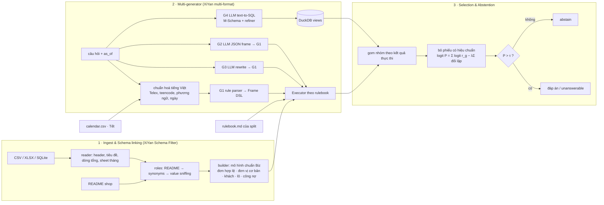

# DataMate-XiYan — Zalo AI Challenge 2026 (DataMate)

Agent trả lời câu hỏi tiếng Việt đời thường trên dữ liệu bảng của cửa hàng nhỏ (CSV / Excel / SQLite),
**biết từ chối khi dữ liệu không đủ** và **biết bỏ trống khi không chắc** — tối ưu trực tiếp cho
*Penalized Accuracy* (đúng +1, sai −1, bỏ trống 0).

Kiến trúc dựa trên **XiYan-SQL: A Novel Multi-Generator Framework for Text-to-SQL** (IEEE TKDE 2026) — lọc
schema → nhiều bộ sinh đa định dạng → tái tổ chức ứng viên theo kết quả thực thi + mô hình chọn — và phần
từ chối trả lời dựa trên **When Silence is Golden: Can LLMs Learn to Abstain in Temporal QA and Beyond?**
(ICLR 2026) — coi abstention là một *quyết định* tối ưu kỳ vọng phần thưởng, học bằng phần thưởng có tính
abstention.

```
{"id": "q_06de33fa21cc", "business_id": "biz_118", "question": "sp bán dc nhiều nhất tuần rồi là gì", "as_of_date": "2026-03-04"}
→ {"id": "q_06de33fa21cc", "type": "string", "answer": "Xi măng Hà Tiên PCB40 bao 50kg"}
```

## 1. Kết quả

| Split | Chế độ | Đúng | Sai | Bỏ trống | PA |
|---|---|---:|---:|---:|---:|
| Train (3.000 câu, 30 shop) | agent CPU (G1 luật + coverage + selector), không LLM | 3.000 | 0 | 0 | **1.000** |
| Train **làm nhiễu kiểu public** (bỏ dấu, Telex, viết tắt, phương ngữ, "Th7/25") | như trên | 2.990 | 0 | 10 | **0.997** |
| Public test — bản nộp 1 | như trên | 850 giá trị + 21 `unanswerable` | ~155 | 129 | **0.561** (BTC chấm) |
| Public test — bản 2 (sau phân tích lỗi, §7 / `docs/RESULTS.md` §2.1) | như trên | 920 giá trị + 22 `unanswerable` | ? | 58 | chưa chấm |

> Kết quả train là **trong mẫu** (luật được phát triển khi phân tích lỗi trên train — không mã hoá đáp án, không
> logic theo id). Bản nhiễu ước lượng độ bền với câu hỏi lộn xộn. Phần LLM (G2–G4) cần GPU nên mới được kiểm
> thử bằng LLM giả lập, chưa đo độ chính xác; xem `docs/RESULTS.md` và §7. File nộp public (chế độ CPU):
> `submissions/public_test_rule_only.jsonl`.

## 2. Kiến trúc



| Thành phần XiYan-SQL | Trong DataMate-XiYan | File |
|---|---|---|
| Schema Filter (multi-path retrieval, column selection) | Liên kết schema cho bảng thô: từ điển cột trong README → từ đồng nghĩa tiêu đề theo *loại bảng* → dò giá trị (mẫu ID `ORD…/PN…/SP…`, biển số, mã lô); phân loại 20+ loại bảng | `datamate/ingest/roles.py` |
| M-Schema | Các view chuẩn đã áp luật (đơn hợp lệ, đơn vị cơ bản…) được trình bày dạng M-Schema cho LLM | `datamate/llm/mschema.py` |
| Value retrieval | Liên kết giá trị: mặt hàng, khách, nhóm hàng, nhóm khách, hoạt chất, nhân viên, nhà cung cấp, đơn vị (khớp n-gram + mờ) | `datamate/nlu/linker.py` |
| Multiple SQL generators (multi-task, multi-format) | G1 luật → Frame DSL; G2 LLM → JSON frame; G3 LLM viết lại câu hỏi chuẩn → G1; G4 LLM → DuckDB SQL | `datamate/nlu/rules.py`, `datamate/llm/generators.py` |
| Refiner | G4 sửa SQL theo lỗi thực thi | `datamate/llm/generators.py` |
| Candidate reorganization + selection model | Gom ứng viên theo kết quả thực thi, bỏ phiếu theo độ tin cậy từng generator × intent (hiệu chuẩn trên train), ngưỡng Chow | `datamate/select/selector.py` |

**Neuro-symbolic:** mọi ngữ nghĩa nghiệp vụ (đơn trả một phần bỏ cả đơn, tuần bắt đầu thứ Hai, "tháng này so
cùng kỳ" lấy cùng số ngày, Tết = 23 tháng Chạp → mùng 10 tháng Giêng, tie-break theo mã, làm tròn nửa lên…)
nằm ở **một chỗ duy nhất** — bộ thực thi `datamate/engine/` — và được kiểm chứng bằng đáp án train. LLM chỉ
làm việc nó giỏi: hiểu câu hỏi lộn xộn; nó *không* tự cộng tiền.

### Từ chối / bỏ trống (When Silence is Golden)

* **Không trả lời được (`unanswerable`)** sinh ra *có bằng chứng*: kỳ nằm hoàn toàn ngoài khoảng dữ liệu, shop không
  ghi loại thông tin (giá vốn, giới tính, địa chỉ, lý do huỷ, nhóm khách…), câu hỏi chủ quan / cần kiến thức ngoài.
* **Bỏ trống (`abstain`)** khi xác suất đúng ước lượng < τ (mặc định 0.6 > 0.5 của luật Chow cho thang +1/0/−1).
  Độ tin cậy của mỗi generator theo từng intent được đo trên train với co rút Bayes (`scripts/calibrate.py`).
* Tín hiệu rủi ro: hoà điểm ở biên top-k (đề đã loại các câu như vậy ⇒ hoà nghĩa là ta hiểu sai), giá trị phi lý,
  rulebook của split đổi luật mà engine đang cài (`datamate/rulebook.py` — kiểm tra cụm từ khoá của từng luật).
* **Kiểm tra hình thức câu hỏi ↔ kiểu đáp án** (`datamate/nlu/consistency.py`): khi bộ luật rơi về intent rộng
  (`revenue`, `units`…) với cách hỏi mới, đáp án *trông* hợp lệ nhưng trả lời câu khác. Hình thức câu tiếng Việt
  ràng buộc kiểu đáp án: "… nào / ai / mô / chi" → tên, "%"/"chiếm" → phần trăm, "lần lượt / từng tháng" → danh
  sách, "… đúng không?" → có/không, "mấy bữa/ngày" → số ngày, "nhóm X" → phải có bộ lọc nhóm. Frame mâu thuẫn ⇒
  độ tin cậy bị chặn dưới τ ⇒ bỏ trống thay vì sai tự tin. Trên train bộ kiểm tra chặn **0** câu đúng.
* Huấn luyện (tuỳ chọn, GPU): SFT đa nhiệm (rewrite / frame / answerability) rồi **GRPO với phần thưởng chính là PA**
  (+1/−1/0, thêm phần thưởng định dạng), đúng pipeline CoT-SFT → RL của bài báo (`training/`).

### Ánh xạ sang các lĩnh vực nghiên cứu

| Lĩnh vực | Thành phần |
|---|---|
| NLP / Vietnamese NLU, Semantic parsing | `textnorm.py` (Telex, teencode, phương ngữ, ngày viết tắt), `nlu/rules.py`, `nlu/frame.py` |
| Database / Schema understanding & linking | `ingest/reader.py`, `ingest/roles.py`, `ingest/builder.py`, `llm/mschema.py` |
| Information Retrieval / RAG | `nlu/linker.py` (value retrieval), `llm/generators.py::ExampleBank` (few-shot TF-IDF) |
| Agentic AI | `agent.py` (điều phối generator, ngân sách thời gian, log) |
| Program synthesis | Frame DSL + G4 text-to-SQL (DuckDB) |
| Mathematical & temporal reasoning | `nlu/timeparse.py` (tuần, cùng kỳ, Tết âm lịch), `engine/executor.py` |
| Trustworthy AI / Abstention | `select/selector.py`, `rulebook.py`, `training/grpo_abstain.py` |
| Generalization | header synonyms theo loại bảng + README + value sniffing; `augment.py` (nhiễu kiểu public) |

## 3. Mô hình sử dụng (khai báo theo Rule 2)

| Mô hình | Tham số | Phát hành | Giấy phép | Vai trò |
|---|---:|---|---|---|
| `Qwen/Qwen3-14B` | 14.8B | 04/2025 | Apache-2.0 | G2/G3/G4 (LLM duy nhất) |

## 4. Cài đặt & chạy

```bash
python -m pip install -r requirements.txt          # Python ≥ 3.10
```

Đặt dữ liệu gốc của BTC vào `data/` (không commit):

```
data/
├── train/         # data/, questions.jsonl, answers.jsonl, rulebook.md, calendar.csv
└── public_test/   # data/, questions.jsonl, rulebook.md, calendar.csv
```

```bash
# chế độ CPU (chỉ G1 luật) – có chấm điểm nếu split có answers.jsonl
python -m datamate.predict --data data/train --out runs/train/submission.jsonl --llm none
python -m datamate.predict --data data/public_test --out runs/public/submission.jsonl --llm none
# chế độ GPU (vLLM, 2 × RTX 5090)
python -m datamate.predict --data data/public_test --out runs/public/submission.jsonl --llm vllm --model /models/llm
```

Đánh giá chi tiết theo intent: `python scripts/eval_rules.py data/train` ;
hiệu chuẩn: `python scripts/calibrate.py eval_rules_out.jsonl artifacts/reliability.json`.

### Docker (nộp cho BTC)

```bash
docker build -t datamate-xiyan:final .                       # tải trọng số Qwen3-14B vào image lúc build
docker run --rm --gpus all --network none \
  -v /path/to/private_test:/data:ro -v $(pwd)/result:/result datamate-xiyan:final
```

`predict.sh` đọc `/data`, ghi `/result/submission.jsonl` (ghi và flush từng shop — nếu bị ngắt giữa chừng
vẫn còn đáp án đã ghi) và `/result/logs/<id>.json` cho từng câu: câu hỏi, frame/SQL/rewrite của từng
generator, nhóm ứng viên và xác suất của bộ chọn, đáp án cuối, thời gian.
Không có truy cập mạng; cache tạm ở `/tmp/datamate_cache` (thư mục dữ liệu chỉ đọc).
`DATAMATE_LLM=none` ⇒ chạy thuần CPU. Ngân sách thời gian mặc định 5.5 h (`DATAMATE_TIME_BUDGET`):
khi gần hết, các generator LLM tự tắt để kịp ghi toàn bộ.

## 5. Cấu trúc repo

```
datamate/
  values.py        parse tiền '1tr440' '25k' '398,8604tr', ngày serial Excel / '1 thg 6 2025', số lượng '2 xe 4m3'
  textnorm.py      chuẩn hoá tiếng Việt (bỏ dấu, sửa Telex, viết tắt, teencode, phương ngữ, ngày tắt)
  ingest/          reader (header/dòng tổng) · roles (schema linking) · readme · builder (mô hình chuẩn)
  nlu/             timeparse (luật thời gian + lịch âm) · linker (+ tên vùng miền: rán/chiên, lạc/đậu phộng…)
                   frame (DSL) · rules (G1) · consistency (hình thức câu ↔ kiểu đáp án) · coverage (OOV)
  domains/         repair (sổ sửa xe, phân loại việc trong ô "Làm gì") · phone (máy mới/cũ, thu máy cũ, bảo hành)
                   books (sổ nợ tự ghi, sổ trả góp: lịch kỳ góp, quá hạn, còn lại)
  engine/          executor (luật rulebook) · answer (Frame → đáp án có kiểu)
  llm/             backend (vLLM/HF/mock) · prompts · mschema · generators (G2/G3/G4)
  select/          selector (gom nhóm + bỏ phiếu hiệu chuẩn + abstain)
  rulebook.py      đọc rulebook của split, kiểm tra luật thay đổi
  agent.py         điều phối · predict.py CLI · scorer.py chấm PA · augment.py sinh nhiễu
scripts/           eval_rules.py · calibrate.py · debug_*.py
                   check_consistency.py (chẩn đoán ingest không cần nhãn) · review_run.py (gom câu theo intent)
                   check_guard.py (bộ kiểm tra hình thức chặn những câu nào) · try_q.py (chạy G1 trên vài câu)
training/          build_sft_data.py · sft_lora.py · grpo_abstain.py
artifacts/         reliability.json · example_bank.jsonl (sinh từ train)
tests/             unit test (không cần dữ liệu)
Dockerfile · predict.sh · requirements*.txt
```

## 6. Tuân thủ thể lệ

* Offline hoàn toàn khi suy luận; trọng số nằm trong image.
* Không mã hoá cứng đáp án, không logic theo `id` câu hỏi hay `business_id`: mọi xử lý suy ra từ file + README + rulebook của split.
* Chỉ dùng **train** (có nhãn) để hiệu chuẩn, few-shot và dữ liệu SFT. Không huấn luyện trên public/private test.
  Câu hỏi public (**không có nhãn**) chỉ được đọc để phân tích lỗi phân tích cú pháp; mọi sửa đổi là luật tổng quát
  (cách nói thời gian, phương ngữ, kiểu câu, sổ chuyên ngành mô tả trong README của shop), không gắn với câu hay shop
  cụ thể, và luôn được kiểm lại trên train (PA phải giữ 1.000, bộ kiểm tra hình thức không chặn câu train nào).
* Tất định: luật thuần Python; LLM nhiệt độ 0, seed cố định; sắp xếp ổn định (tie-break theo mã).
* Ghi log từng câu (id, đáp án, thời gian, bằng chứng) theo yêu cầu Rule 8.

## 7. Hạn chế & hướng tiếp

* Public/private có loại hình mới (điện thoại, sửa xe, mẹ & bé…) với sổ chuyên biệt; đã mô hình hoá sổ sửa xe (kể cả
  đếm theo loại việc), thu máy cũ, sổ bảo hành, size/hãng, sổ nợ tự ghi và sổ trả góp. Shop không có cột nhóm hàng mà câu
  hỏi nêu "nhóm X" thì bỏ trống. Cách hỏi hoàn toàn mới vẫn dựa vào G2–G4 hoặc bỏ trống (bộ kiểm tra hình thức).
* Số liệu LLM chưa đo do môi trường phát triển không có GPU; chạy `training/` + `scripts/calibrate.py` trên log
  GPU để hiệu chuẩn lại `artifacts/reliability.json` trước khi nộp.
