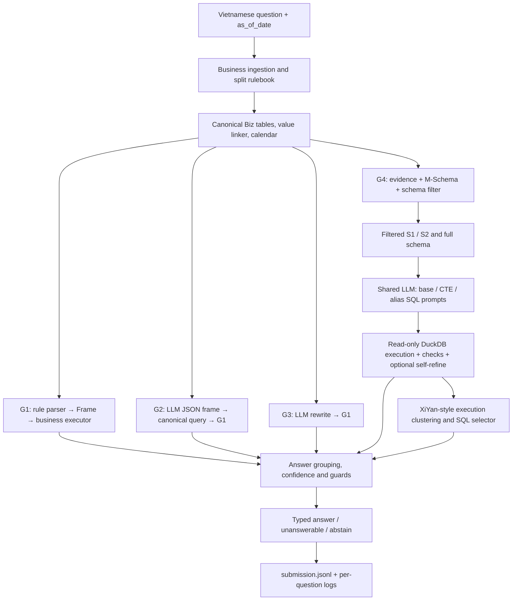

# DataMate-XiYan

**Vietnamese business-table question answering with a neuro-symbolic ensemble, XiYan-inspired Text-to-SQL, and selective abstention.**

Research/competition implementation for the **Zalo AI Challenge 2026 — DataMate track**. This repository is **not** the official XiYan-SQL implementation or a faithful reproduction of its reported benchmark results.

> **Project status (4 Nov 2026).** The rule-based path (G1), the shared-LLM paths (G2/G3/G4), schema filtering, SQL execution, candidate selection, LoRA training scripts, and a **Phase-A QLoRA adapter** are present. Phase-A held-out results are recorded in `models/adapter/TRAINING.md`. The evaluation record contains **official public leaderboard scores for particular submission files** (identified by their sha256 prefix in `submissions/`), not a confirmed score for every commit; the code on `main` after the 0.909 file has not been scored yet. Phase-B training, GRPO, end-to-end private-test performance, and a six-hour offline Docker rerun are **not established** by the current records. See [Experiment status](docs/EXPERIMENTS.md).

## At a glance

A business may store orders, inventory, payments and customer information across CSV, Excel and SQLite files, with inconsistent names and informal Vietnamese descriptions. Given a question such as *"Tuần rồi mặt hàng nào bán chạy nhất?"*, the system must identify the relevant records, apply the **split's** business rules and relative dates, compute a typed answer, or refrain from guessing.

**Inputs:** business data directory + business README, `questions.jsonl`, `rulebook.md`, `calendar.csv`. Each question includes `id`, `business_id`, `question` and `as_of_date`.

**Outputs:** one JSON object per question in `submission.jsonl`, with type `number`, `percent`, `string`, `date`, `boolean`, `list`, `table`, `unanswerable`, or `abstain`.

```json
{"id":"q_example","business_id":"biz_example","question":"Doanh thu tháng này là bao nhiêu?","as_of_date":"2026-08-27"}
```

The sample above illustrates the **input schema**, not a real business or a computed result. The model does **not** invent numbers; it reads the business's files and uses the business engine or SQL executor.

**Scoring:** Penalized Accuracy, PA = (correct − wrong) / total; correct **+1**, wrong **−1**, abstain **0**. Importantly, `unanswerable` is a substantive claim that the data cannot answer the question and can be **wrong**; `abstain` is the agent declining to answer and receives zero. If probability of correctness were perfectly calibrated, answering would have positive expected reward above 0.5; this implementation defaults to a conservative decision threshold `tau = 0.6`.

## How it works



The four routes are **not four independent foundation models**:

| Route | Role | Where to read |
|---|---|---|
| **G1 — Rules** | Vietnamese semantic parser → Frame DSL → deterministic business calculations. Always attempted. | `datamate/nlu/rules.py`, `datamate/engine/answer.py` |
| **G2 — Frame** | Shared LLM generates a structured frame; rendered as a canonical question and executed through G1. | `datamate/llm/generators.py` |
| **G3 — Rewrite** | Shared LLM normalizes noisy Vietnamese; the rewritten question is processed by G1. | `datamate/llm/generators.py` |
| **G4 — SQL** | XiYan-inspired per-question schema filtering, multi-schema/multi-format SQL, execution feedback, SQL selection. | `datamate/llm/schema_filter.py`, `datamate/llm/sql_pipeline.py` |
| **Final selector** | Groups **executed answers**, discounts correlated LLM outputs, applies risk guards and the abstention threshold. | `datamate/select/selector.py` |

**Model identity matters:** G2, G3, G4 variants, and the SQL selection model use the same Qwen3-14B backbone when enabled. Generating three different SQL prompt formats is **not** equivalent to the four separately fine-tuned expert generators of the XiYan-SQL paper. For details, see [Algorithm-to-code map](docs/XIYAN_ADAPTATION.md).

### A concrete example

For *"Tuần rồi mặt hàng nào bán chạy nhất?"*:

1. Ingestion interprets the relevant sales files and shop README; temporal parsing resolves *"tuần rồi"* using `as_of_date` and the current split's rulebook.
2. G1 tries to identify a ranking intent, quantity measure, sales validity conditions, and necessary filters.
3. If the LLM is enabled, G2/G3 may propose alternative interpretations; for G4, retrieved schema/evidence guide SQL generation.
4. SQL candidates are **executed**, not accepted merely because their syntax looks plausible; execution errors may trigger one self-refine attempt.
5. Candidate answers are checked and grouped. The final selector returns a value only when it passes eligibility and confidence checks; otherwise it can abstain.

This is an illustrative control flow, **not a prediction for the example question without its files**.

## Quick start — CPU / G1 only

**Requirements:** Python 3.10+ and the competition split directories in their expected layout. No GPU or LLM weights are needed for the CPU path.

```bash
# GIT_LFS_SKIP_SMUDGE=1: skip the 0.26 GB adapter (Git LFS) that the CPU path does not need
GIT_LFS_SKIP_SMUDGE=1 git clone https://github.com/AIVIETNAM-AIO-khaisiubeo/datamate-xiyan-.git
cd datamate-xiyan-
python -m pip install -r requirements.txt
python -m pip install pytest
python -m pytest -q tests/
```

Data layout expected by the CLI:

```text
data/
  train/
    data/<business_id>/{README.md, *.csv|*.xlsx|*.sqlite}
    questions.jsonl
    answers.jsonl
    rulebook.md
    calendar.csv
  public_test/
    data/<business_id>/...
    questions.jsonl
    rulebook.md
    calendar.csv
```

The repository includes competition split files; if using a different checkout, put the supplied, **unmodified** split directories in the locations above. Do not use public/private-test questions or data for training, adapter tuning, or calibration.

```bash
# Small smoke test (first 10 training questions)
python -m datamate.predict --data data/train \
  --out runs/smoke/submission.jsonl --llm none --limit 10

# Full local training-split evaluation; answers.jsonl enables local PA
python -m datamate.predict --data data/train \
  --out runs/train/submission.jsonl --llm none

# Public-test prediction (no public labels available)
python -m datamate.predict --data data/public_test \
  --out runs/public/submission.jsonl --llm none

python scripts/check_submission.py \
  runs/public/submission.jsonl data/public_test/questions.jsonl
```

This executes **inference/evaluation**, not model training. Each run produces question-level logs under `runs/<name>/logs/`.

## GPU inference and the Phase-A adapter

The currently documented approach uses a shared **Qwen3-14B** model and optionally a QLoRA-trained adapter. The LLM backend must load **local weights**; inference is designed to be offline. In a local shell with compatible GPUs and a functioning vLLM installation:

```bash
# Fails explicitly rather than silently degrading to G1-only.
python -m datamate.predict --data data/public_test \
  --out runs/public_llm/submission.jsonl \
  --llm vllm --model /models/llm --lora models/adapter \
  --tp 2 --require-llm

python scripts/check_submission.py \
  runs/public_llm/submission.jsonl data/public_test/questions.jsonl
```

Run `git lfs pull` to obtain real adapter weights (not just the LFS pointer), and check `python scripts/count_params.py /models/llm models/adapter`. The model-loading path can fall back to rule-only **unless `--require-llm` is set**. Do not report a fallback run as LLM performance.

**Step-by-step GPU/Colab/QLoRA instructions:** [GPU guide](docs/GPU_FINETUNE_GUIDE.md) · [Colab guide](docs/COLAB_GUIDE.md) · [Adapter provenance](models/adapter/TRAINING.md). Phase A is documented; Phase B and GRPO are not presented as completed.

## Evaluation snapshot

These numbers are **reported in repository records**, not independently re-measured here. See [Results and provenance](docs/RESULTS.md) and [How to interpret the experiments](docs/EXPERIMENTS.md).

| Setting / artifact | Reported result | Interpretation |
|---|---:|---|
| G1 on 3,000 training questions | PA **1.000** | **In-sample**; rule logic was developed using training data |
| Official public leaderboard: earlier G1 submission | PA **0.561** | Historical public submission |
| Official public leaderboard: revised G1 submission | PA **0.912** | Developed after reviewing **unlabelled public data/questions**; optimistic generalization estimate |
| Official public leaderboard: initial Phase-A LoRA ensemble | PA **0.777** | Older selector and SQL-extraction issue |
| Official public leaderboard: later Phase-A T4/AWQ run (`…_7b_8124e92b.jsonl`) | PA **0.895** | New selector (one vote per model, G1 anchor), G4 fixed |
| Official public leaderboard: 7c replay of that run (`…_final_de716e81.jsonl`) | PA **0.909** | Calibrated LLM dissent + form/rulebook guards, CPU replay of the 0.895 logs |
| Phase-A held-out business fold, **noisy copy** | LLM-only PA: base **0.947**, LoRA **0.982** | Local evaluation on held-out businesses, **not** official public/private PA |
| Next 7c file (code on `main`: agreement fix, zero/hour/quality guards, `__solo__`) | **Not produced or scored yet** | Label-free bound from the 0.909 logs: 0.895–0.923. Do not assign an earlier score to a new file |

Which file got which score, and which tag holds the run that produced it: [`submissions/README.md`](submissions/README.md).

SQL compilation, schema recall, SQL-lint mutation tests, and synthetic perturbation results are **component measurements**; they do not substitute for independently measured end-to-end accuracy on unseen businesses.

## Repository map

```text
datamate/
  agent.py                 orchestration, G1→LLM routes→final selector, logs
  predict.py               command-line inference
  ingest/                  CSV/Excel/SQLite reading, normalization, Biz
  nlu/                     Vietnamese normalization, Frame, time, linking, coverage
  domains/                 domain-specific ledgers (repair, phone, books)
  engine/                  deterministic business logic and typed answers
  llm/                     model backends, M-Schema, schema filter, SQL pipeline
  select/                  SQL checks, selection model, calibrated final selector
training/                  SFT data, (Q)LoRA fine-tuning, experimental GRPO
scripts/                   artifacts, evaluation, calibration, submission validation
tests/                     unit and mock-LLM integration tests
artifacts/                 training-derived example bank, silver SQL, reliability
models/adapter/            Phase-A LoRA adapter + training notes (Git LFS)
notebooks/                 Colab workflow
docs/                      method, evaluation and environment instructions
data/                      competition split data
submissions/               historical submission files
Dockerfile*                deployment variants; predict.sh is container entry point
```

## Documentation — suggested reading order

| You want to... | Read |
|---|---|
| Understand the end-to-end flow and module responsibilities | [Architecture](docs/ARCHITECTURE.md) |
| Understand Algorithm 1–3, G4, multi-task SFT and differences from XiYan-SQL | [XiYan adaptation](docs/XIYAN_ADAPTATION.md) |
| Evaluate claims, reproductions, dataset leakage risks and open issues | [Experiments](docs/EXPERIMENTS.md), [historical results](docs/RESULTS.md) |
| Train or use the adapter | [GPU guide](docs/GPU_FINETUNE_GUIDE.md), [Colab guide](docs/COLAB_GUIDE.md) |
| Build a competition container | [Deployment details](docs/ARCHITECTURE.md#submission-and-offline-deployment), `Dockerfile.lora`, `predict.sh` |
| Explore all documents | [Documentation index](docs/README.md) |

## Constraints, limitations and research context

The competition requires **≤15B total inference-model parameters**, **offline inference**, **no human intervention**, no training on test splits, a **six-hour private-test runtime limit**, and deterministic-enough reproducibility. Qwen3-14B with one adapter is the intended configuration; verify the exact model artifacts, licenses, release dates, parameter count and Docker environment before final submission.

Known limitations include **highly optimized G1 training performance**, fragile coverage of new business schemas, shared-model correlation across G2–G4, SQL support/selection errors on questions G1 cannot answer, and unverified private-test accuracy and end-to-end runtime. The current G4 is **XiYan-inspired**, not the five independently trained generator configuration in the paper. **GRPO exists as experimental code, not a demonstrated trained model.**

**Research foundations:** Yifu Liu et al., [*XiYan-SQL: A Novel Multi-Generator Framework for Text-to-SQL*](https://doi.org/10.1109/TKDE.2026.3657851), IEEE TKDE (2026); Xinyu Zhou et al., *When Silence Is Golden: Can LLMs Learn to Abstain in Temporal QA and Beyond?*, ICLR (2026). The first informs schema filtering/SQL candidate generation/selection; the second motivates abstention-aware training. The contest's PA-based decision logic is an **adaptation**, not a replicated result from either paper.

## Branches and tags

| Ref | What it is |
|---|---|
| `main` | Everything: current code, documentation, the Phase-A adapter (Git LFS), every scored submission file |
| `gpu-finetune-guide` | Working branch; merged into `main` after each verified step |
| `colab-results` | Written by the Colab notebook (section 8): the latest run's adapter, reliability and submission files on top of `main`. Overwritten by the next run; each run is also kept as a tag |
| tags `run-0.777`, `run-0.895`, `run-0.909` | The exact Colab commits behind the three LLM leaderboard submissions (formerly branches `colab-finetune-phasea…`) |

---
**Maintainer note:** Documentation describes `main` as of **2026-11-04**. Use the exact artifact hash (sha256 prefix in the file name) when quoting a score.
