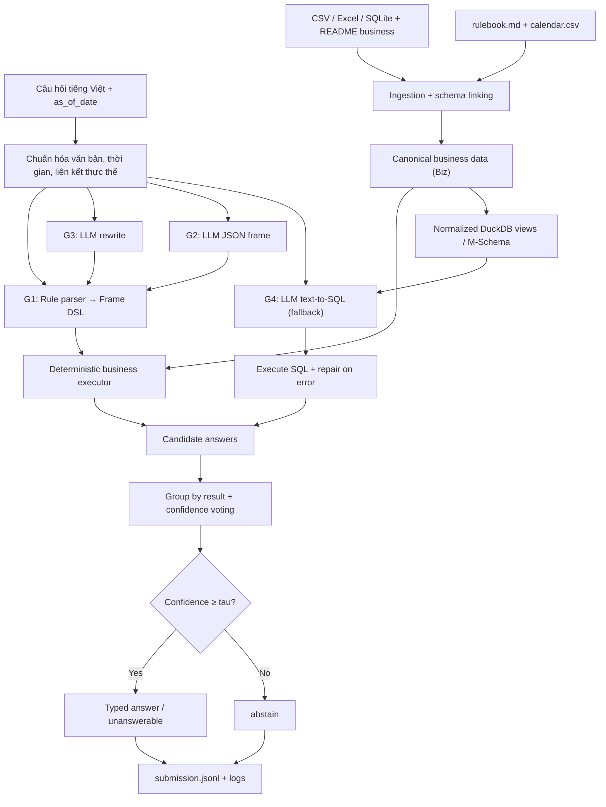

# DataMate-XiYan

**Neuro-symbolic, multi-generator agent for Vietnamese question answering over business tables**  
*Zalo AI Challenge 2026 — DataMate track*

DataMate-XiYan trả lời câu hỏi tiếng Việt đời thường trực tiếp từ dữ liệu kinh doanh **CSV, Excel và SQLite**. Hệ thống kết hợp **bộ phân tích luật (rule-based semantic parser)**, các **LLM generators lấy cảm hứng từ XiYan-SQL**, một bộ thực thi xác định và cơ chế **abstention** nhằm tối ưu **Penalized Accuracy (PA)**.

> **Trạng thái hiện tại:** Chế độ **CPU / G1 rule-only** đã có kết quả đánh giá. Code cho G2–G4 sử dụng **Qwen3-14B**, SFT LoRA và GRPO đã có trong repo, nhưng **chưa có benchmark thực tế cho pipeline LLM**. Không nên hiểu điểm PA công bố dưới đây là kết quả của mô hình đã fine-tune.

## Nội dung

1. [Bài toán và mục tiêu](#1-bài-toán-và-mục-tiêu)
2. [Quick start — chạy trong vài bước](#2-quick-start--chạy-trong-vài-bước)
3. [Kiến trúc và quy trình xử lý](#3-kiến-trúc-và-quy-trình-xử-lý)
4. [Kết quả thực nghiệm](#4-kết-quả-thực-nghiệm)
5. [Cấu trúc repository](#5-cấu-trúc-repository)
6. [Huấn luyện và sử dụng LLM](#6-huấn-luyện-và-sử-dụng-llm)
7. [Đánh giá và kiểm soát độ tin cậy](#7-đánh-giá-và-kiểm-soát-độ-tin-cậy)
8. [Docker và submission](#8-docker-và-submission)
9. [Giới hạn và hướng phát triển](#9-giới-hạn-và-hướng-phát-triển)

## 1. Bài toán và mục tiêu

### DataMate giải quyết vấn đề gì?

Một cửa hàng có thể lưu bán hàng, nhập hàng, tồn kho, công nợ và khách hàng trong nhiều file có cấu trúc khác nhau. Người dùng không biết SQL vẫn muốn hỏi bằng ngôn ngữ tự nhiên, chẳng hạn:

- “Tuần rồi bán chạy nhất mặt hàng gì?”
- “Doanh thu từ đầu tháng đến hôm nay là bao nhiêu?”
- “Khách nào còn nợ nhiều nhất?”
- “Tỷ lệ đơn hủy tháng trước là bao nhiêu?”

Agent cần **hiểu câu hỏi, đọc đúng bảng, tuân thủ luật nghiệp vụ và tính kết quả từ dữ liệu**, không tự phỏng đoán con số.

**Đầu vào của mỗi câu hỏi** gồm `business_id`, nội dung `question` và `as_of_date` (ngày dùng để diễn giải “hôm nay”, “tuần trước”, “tháng này”...). Mỗi business có dữ liệu thô cùng `README.md`; mỗi split có `rulebook.md` và `calendar.csv`.

```json
{"id":"q_06de33fa21cc","business_id":"biz_118","question":"sp bán dc nhiều nhất tuần rồi là gì","as_of_date":"2026-03-04"}
```

**Đầu ra** là một bản ghi JSONL có kiểu đáp án chính xác theo đề bài:

```json
{"id":"q_06de33fa21cc","type":"string","answer":"Xi măng Hà Tiên PCB40 bao 50kg"}
```

Các kiểu hỗ trợ: `number`, `percent`, `string`, `date`, `boolean`, `list`, `table`, `unanswerable` và `abstain`.

**`unanswerable` khác `abstain`:**

- `unanswerable`: dữ liệu **không đủ để trả lời**; đây là một đáp án có thể được chấm đúng hoặc sai.
- `abstain`: agent **chủ động không trả lời** vì độ tin cậy chưa đủ; nhận 0 điểm.

### Thước đo: Penalized Accuracy

```text
PA = (số câu đúng − số câu sai) / tổng số câu
Đúng: +1     Sai: −1     Abstain: 0
```

Vì trả lời sai bị trừ điểm, mục tiêu **không phải trả lời càng nhiều câu càng tốt** mà là chọn những câu có khả năng đúng đủ cao. Ngưỡng lý thuyết để trả lời, nếu xác suất được hiệu chỉnh chuẩn, là `P(correct) > 0.5`. Repo hiện đặt ngưỡng mặc định `tau = 0.6` trong `datamate/agent.py`.

## 2. Quick start — chạy trong vài bước

### Yêu cầu

- Python **3.10+**.
- **Chỉ dùng G1 / CPU:** không cần tải LLM hay có GPU.
- **Dùng G2–G4 / GPU:** cần trọng số mô hình ở đường dẫn local và môi trường `vllm` hoặc `transformers` tương thích.

### Bước 1 — Clone và cài dependencies

```bash
git clone https://github.com/AIVIETNAM-AIO-khaisiubeo/datamate-xiyan-.git
cd datamate-xiyan-
python -m pip install -r requirements.txt
```

### Bước 2 — Đặt dữ liệu cuộc thi

Hai split **đã giải nén** được đặt như sau:

```text
data/
├── train/
│   ├── data/
│   │   ├── <business_id>/
│   │   │   ├── README.md
│   │   │   └── *.csv | *.xlsx | *.sqlite
│   │   └── ...
│   ├── questions.jsonl
│   ├── answers.jsonl
│   ├── rulebook.md
│   └── calendar.csv
└── public_test/
    ├── data/
    ├── questions.jsonl
    ├── rulebook.md
    └── calendar.csv
```

> Dữ liệu gốc của ban tổ chức **không nằm sẵn trong repo**. Không commit các bộ dữ liệu của cuộc thi. `public_test` không có `answers.jsonl`.

### Bước 3 — Kiểm thử nhanh trên CPU

```bash
# Chạy 10 câu đầu để kiểm tra luồng xử lý và định dạng đầu ra
python -m datamate.predict --data data/train --out runs/smoke/submission.jsonl --llm none --limit 10

# Chạy toàn bộ train; CLI tự in PA khi có answers.jsonl
python -m datamate.predict --data data/train --out runs/train/submission.jsonl --llm none

# Tạo file nộp public test bằng G1 rule-only
python -m datamate.predict --data data/public_test --out runs/public/submission.jsonl --llm none
```

**File cần nộp:** `runs/public/submission.jsonl`. Log cho từng câu nằm trong thư mục `logs/` cạnh file đầu ra (mặc định).

**Lưu ý:** lệnh train ở trên là **chạy inference/evaluation trên train**, không cập nhật trọng số mô hình. Quy trình fine-tuning thật nằm ở [Mục 6](#6-huấn-luyện-và-sử-dụng-llm).

### Bước 4 — Chạy unit tests

```bash
python -m pip install pytest
python -m pytest -q tests/
```

Test mock-LLM ở `tests/test_agent_mock.py` tự bỏ qua khi không có dữ liệu train. Test này kiểm tra luồng tích hợp, **không đo chất lượng Qwen3-14B**.

## 3. Kiến trúc và quy trình xử lý

Hệ thống **không dùng LLM để tự tính tiền hay đếm số đơn**. LLM chủ yếu hỗ trợ hiểu yêu cầu và sinh truy vấn; phép tính được giao cho business engine hoặc DuckDB.



*G3 và G2 tạo ứng viên thông qua G1, còn G4 là nhánh SQL dự phòng khi các ứng viên hiện có chưa đủ tin cậy. G2–G4 chỉ chạy khi bật backend LLM và còn ngân sách thời gian.*

### 3.1. Ingestion & Schema Linking

**Code:** `datamate/ingest/`, `datamate/values.py`.

Đọc dữ liệu CSV/XLSX/SQLite không đồng nhất, xử lý header, sheet, dòng tổng, tên cột, đơn vị và các dạng ghi tiền/ngày. Thông tin từ README của từng shop, từ đồng nghĩa cột và mẫu giá trị được dùng để ánh xạ về **mô hình dữ liệu chuẩn `Biz`**.

Các bảng nghiệp vụ chuẩn bao gồm đơn hàng, dòng bán, danh mục hàng, nhập hàng, thanh toán, tồn kho và dữ liệu liên quan khi có sẵn. Phần `datamate/domains/` bổ sung xử lý cho sổ sửa xe, điện thoại/bảo hành và sổ nợ/trả góp.

### 3.2. Vietnamese NLU & Temporal Reasoning

**Code:** `datamate/textnorm.py`, `datamate/nlu/`.

- Chuẩn hóa tiếng Việt không dấu, Telex, teencode, viết tắt và biến thể vùng miền.
- Liên kết tên mặt hàng, nhóm hàng, khách hàng và thuộc tính trong câu hỏi.
- Diễn giải mốc thời gian dựa trên `as_of_date`; dùng lịch âm cho những khoảng Tết.
- Chuyển yêu cầu thành **Frame DSL**: intent, khoảng thời gian, bộ lọc, tiêu chí xếp hạng và kiểu trả lời.

### 3.3. Bốn generator

| Generator | Chức năng | Cách tạo kết quả |
|---|---|---|
| **G1 — Rule** | Phân tích trực tiếp câu hỏi bằng luật | Frame DSL → deterministic executor |
| **G2 — JSON Frame** | LLM trích intent/time/filter | JSON → câu hỏi chuẩn → G1 |
| **G3 — Rewrite** | LLM viết lại câu hỏi nhiễu | Câu viết lại → G1 |
| **G4 — Text-to-SQL** | Dự phòng cho câu chưa được giải quyết | SQL trên DuckDB views, sửa một lượt khi lỗi thực thi |

**Code:** `datamate/nlu/rules.py`, `datamate/llm/generators.py`, `datamate/llm/mschema.py`.  
Một `ExampleBank` từ train hỗ trợ few-shot retrieval; G4 nhận M-Schema của các view đã chuẩn hóa.

### 3.4. Business Engine

**Code:** `datamate/engine/executor.py`, `datamate/engine/answer.py`, `datamate/rulebook.py`.

Các phép tính tuân theo quy tắc nghiệp vụ của split: loại đơn hủy/trả hàng theo luật, lượng bán quy về đơn vị cơ bản, doanh thu, công nợ, ranking, so sánh kỳ, VAT/phí giao hàng và quy tắc làm tròn. `rulebook.py` phát hiện những luật có vẻ khác cách hiểu mặc định để giảm độ tin cậy của intent bị ảnh hưởng.

### 3.5. Candidate Selection & Abstention

**Code:** `datamate/select/selector.py`, `datamate/nlu/consistency.py`, `datamate/nlu/coverage.py`.

Mỗi generator có thể đưa ra một đáp án ứng viên. Selector **gom nhóm theo giá trị đáp án đã thực thi**, kết hợp độ tin cậy theo generator/intent và trừ điểm khi các ứng viên mâu thuẫn. Các tín hiệu rủi ro gồm từ chưa giải thích được, câu hỏi và kiểu đáp án mâu thuẫn, tie ở ranh giới top-k hoặc luật nghiệp vụ thay đổi.

Hệ thống trả lời khi điểm tin cậy qua ngưỡng, ngược lại chọn `abstain`. Các xác suất này là **ước lượng heuristic/calibrated reliability**, chưa nên coi là xác suất thống kê được hiệu chỉnh hoàn hảo trên dữ liệu chưa gặp.

## 4. Kết quả thực nghiệm

Các số dưới đây lấy từ báo cáo hiện có tại [`docs/RESULTS.md`](docs/RESULTS.md). Đây là kết quả **G1 + coverage + selector trên CPU**, không phải kết quả LLM.

| Split / phiên bản | Đáp án giá trị | `unanswerable` | `abstain` | PA |
|---|---:|---:|---:|---:|
| Train (3.000 câu, 30 business) | — | — | 0 | **1.000** |
| Train làm nhiễu (bỏ dấu, Telex, viết tắt…) | — | — | 10 | **0.997** |
| Public test, submission 1 (1.000 câu) | 850 | 21 | 129 | **0.561** (điểm BTC) |
| Public test, phiên bản 2 | 920 | 22 | 58 | **Chưa chấm** |

- **Train:** 3.000 đúng, 0 sai, 0 abstain. Đây là kết quả **trong mẫu**, do luật được phát triển khi phân tích train; **không** phải phép đo generalization độc lập.
- **Train làm nhiễu:** 2.990 đúng, 0 sai, 10 abstain theo báo cáo.
- **Public bản 1:** PA 0.561 do leaderboard cung cấp; số câu đúng/sai không được gắn nhãn trong public test.
- **Public bản 2:** số câu trả lời và bỏ trống là thống kê inference. **Chưa có điểm PA xác nhận**, vì không có ground-truth public.

Chi tiết breakdown theo intent, thay đổi giữa hai bản và phân tích lỗi nằm trong [báo cáo kết quả](docs/RESULTS.md). File kết quả CPU được lưu tại [`submissions/public_test_rule_only.jsonl`](submissions/public_test_rule_only.jsonl).

## 5. Cấu trúc repository

```text
datamate-xiyan-/
├── datamate/                   # Runtime inference
│   ├── agent.py                # Orchestrator: G1–G4, selector, logs
│   ├── predict.py              # CLI tạo submission.jsonl
│   ├── ingest/                 # CSV/Excel/SQLite → canonical Biz
│   ├── nlu/                    # Rule parser, Frame, time, linking, guards
│   ├── domains/                # Sửa xe, điện thoại, sổ nợ/trả góp
│   ├── engine/                 # Business execution & answer formatting
│   ├── llm/                    # Backends, prompts, generators, M-Schema
│   ├── select/                 # Voting, reliability, abstention
│   ├── rulebook.py             # Split-specific business rules
│   ├── scorer.py               # Local Penalized Accuracy scorer
│   ├── textnorm.py             # Chuẩn hóa tiếng Việt
│   └── augment.py              # Tạo nhiễu câu hỏi train
├── training/
│   ├── build_sft_data.py       # Sinh dữ liệu rewrite/frame/answerability
│   ├── sft_lora.py             # LoRA supervised fine-tuning
│   └── grpo_abstain.py         # RL với reward +1 / −1 / 0
├── scripts/
│   ├── build_artifacts.py      # Tạo train-derived vocabulary/few-shot bank
│   ├── eval_rules.py           # Đánh giá G1 theo intent
│   ├── calibrate.py            # Hiệu chuẩn reliability theo intent
│   └── ...                     # Công cụ kiểm tra và debug
├── artifacts/                  # Vocab, example bank, reliability
├── tests/                      # Unit tests và mock-LLM integration test
├── docs/RESULTS.md             # Số liệu và phân tích thực nghiệm
├── submissions/                # File submission CPU hiện có
├── data/                       # Nơi đặt train/public_test (không commit)
├── requirements.txt
├── requirements-train.txt
├── Dockerfile
└── predict.sh                  # Entry point của Docker
```

**Nên đọc code theo thứ tự:** `datamate/predict.py` → `datamate/agent.py` → `datamate/nlu/rules.py` → `datamate/engine/` → `datamate/select/selector.py`. Sau đó mới xem các generator trong `datamate/llm/`.

## 6. Huấn luyện và sử dụng LLM

### 6.1. Backbone và vai trò

| Model | Tham số theo model card | Vai trò dự kiến |
|---|---:|---|
| `Qwen/Qwen3-14B` | khoảng **14.8B** | LLM dùng chung cho G2, G3, G4 |

Model không bắt buộc ở chế độ CPU. Code hỗ trợ `none`, `vllm` và `hf` qua `datamate/llm/backend.py`.

**Giới hạn cuộc thi:** tổng tham số của **mọi model dùng tại inference** phải không vượt **15B** (không chỉ tham số đang được load vào GPU). Kiểm tra tổng sau khi bổ sung adapter hoặc model phụ; khai báo weights/license trong bản nộp.

### 6.2. Tạo artifacts từ train

```bash
python scripts/build_artifacts.py data/train
python scripts/eval_rules.py data/train
python scripts/calibrate.py eval_rules_out.jsonl artifacts/reliability.json
```

Những bước này tạo hoặc cập nhật vocabulary, few-shot example bank và reliability theo intent. `eval_rules.py` ghi `eval_rules_out.jsonl` ở thư mục làm việc hiện hành.

### 6.3. Tạo dữ liệu SFT

```bash
python training/build_sft_data.py \
  --split data/train \
  --out outputs/sft.jsonl \
  --n-aug 3
```

Mỗi ví dụ huấn luyện được tạo từ frame G1 **đã khớp đáp án train**; mục tiêu SFT bao gồm **rewrite**, **JSON frame** và **answerability**. Dữ liệu train có thể được augment bằng các biến thể câu hỏi tiếng Việt.

### 6.4. SFT LoRA (GPU)

```bash
python -m pip install -r requirements-train.txt

python training/sft_lora.py \
  --model /models/llm \
  --data outputs/sft.jsonl \
  --out outputs/lora_sft
```

**Quan trọng:** script `training/sft_lora.py` hiện load backbone ở **BF16** và áp dụng **LoRA**; **chưa cài QLoRA 4-bit/NF4**. Vì vậy không nên mặc định script hiện tại chạy được trên GPU Colab 16–24 GB. Cần kiểm tra VRAM và khả năng tương thích phiên bản `transformers/trl/peft` khi train thực tế.

Để gộp adapter vào backbone:

```bash
python training/sft_lora.py \
  --merge \
  --model /models/llm \
  --adapter outputs/lora_sft \
  --out outputs/merged
```

### 6.5. GRPO với reward theo PA (thử nghiệm)

```bash
python training/grpo_abstain.py \
  --model outputs/merged \
  --split data/train \
  --out outputs/grpo
```

Thiết kế reward có điểm **+1 khi đúng, −1 khi sai, 0 khi abstain**, cộng phần thưởng/penalty định dạng. Đây là **code huấn luyện thử nghiệm**, chưa có xác nhận train thành công hay cải thiện PA.

### 6.6. Inference với LLM

Khi đã có **model local** và GPU tương thích:

```bash
# vLLM
python -m datamate.predict \
  --data data/public_test \
  --out runs/public_llm/submission.jsonl \
  --llm vllm \
  --model /models/llm

# Transformers fallback
python -m datamate.predict \
  --data data/public_test \
  --out runs/public_hf/submission.jsonl \
  --llm hf \
  --model /models/llm
```

Nếu model không load được, backend có cơ chế **fallback sang G1 rule-only**. Kiểm tra log trước khi diễn giải kết quả là của LLM. Mã inference **không tự nạp LoRA adapter riêng biệt** từ thư mục `outputs/lora_sft`; dùng model đã merge hoặc tích hợp adapter vào backend trước khi đánh giá.

## 7. Đánh giá và kiểm soát độ tin cậy

### Đánh giá G1 theo intent

```bash
python scripts/eval_rules.py data/train
```

Chương trình ghi các trường như câu hỏi, intent, frame, đáp án dự đoán, reference và score để phân tích từng loại lỗi. Có thể dùng `scripts/review_run.py`, `scripts/check_consistency.py` và `scripts/check_guard.py` để chẩn đoán thêm.

### Các lớp kiểm tra trước khi trả lời

- **Business consistency:** đơn hợp lệ, đơn vị, thời gian, điều kiện lọc và luật của split.
- **Semantic coverage:** câu hỏi có khái niệm chưa được parser giải thích hay không.
- **Answer-type consistency:** ví dụ câu hỏi “ai/mặt hàng nào” nhưng trả về số; hỏi “bao nhiêu %” nhưng trả tiền.
- **Selection confidence:** ứng viên đồng thuận hay mâu thuẫn; có tie ở biên ranking; có dấu hiệu giá trị không hợp lý.
- **Selective prediction:** chọn `abstain` nếu độ tin cậy dưới ngưỡng.

> `datamate/scorer.py` là **scorer nội bộ**. Trước khi so sánh sát với leaderboard, cần kiểm toán sự phù hợp với quy tắc chấm chính thức, đặc biệt **exact numeric matching, string normalization và table column matching**. Điểm chính thức do ban tổ chức xác nhận.

**Nguyên tắc dữ liệu:** chỉ dùng nhãn của **train** để xây artifacts, học mô hình và hiệu chỉnh. Không dùng `public_test` hay `private_test` cho training hoặc thu thập đáp án tham chiếu. Để ước lượng generalization, nên giữ riêng một validation split theo **business** trước khi tối ưu tiếp.

## 8. Docker và submission

Theo thiết kế cuộc thi, image phải chạy **offline**, đọc test split từ `/data` (read-only) và ghi kết quả vào `/result`.

```bash
docker build -t datamate-xiyan:final .

docker run --rm --gpus all --network none \
  -v /absolute/path/to/test_split:/data:ro \
  -v "$(pwd)/result:/result" \
  datamate-xiyan:final
```

- `predict.sh` là entry point, chạy `datamate.predict`.
- `/result/submission.jsonl` là file nộp chính.
- `/result/logs/<question_id>.json` chứa thông tin ứng viên, đáp án chọn và thời gian.
- `DATAMATE_LLM=none` cho phép chạy không dùng LLM; `DATAMATE_TIME_BUDGET` điều chỉnh ngân sách thời gian.
- `Dockerfile` tải Qwen3-14B **lúc build image** để inference có thể chạy offline. Model weights **không được commit trong repo**.

**Trước khi nộp Docker cuối cùng:** kiểm tra base image theo guideline ban tổ chức (CUDA/Blackwell), model/license và tổng tham số, logs, giới hạn **6 giờ**, tính tái lập và chạy thử với `--network none`. Việc code có Dockerfile **không đồng nghĩa** image đã được kiểm chứng thành công trên 2 × RTX 5090.

## 9. Giới hạn và hướng phát triển

1. **Generalization:** train đạt 1.000 nhưng đó là kết quả trong mẫu; public bản 1 đạt 0.561. Các cách diễn đạt mới, bảng có schema lạ và business chưa gặp vẫn là thách thức.
2. **LLM chưa được benchmark:** G2/G3/G4 mới được thử bằng mock LLM. Cần chạy inference thật với Qwen3-14B và so sánh PA trên validation độc lập.
3. **Training GPU còn thử nghiệm:** script SFT hiện là LoRA BF16, không phải QLoRA; GRPO chưa có số liệu xác nhận.
4. **Calibration:** reliability theo intent đang lấy từ train và có thể quá lạc quan; cần business-level holdout và ablation `G1` so với `G1+G2+G3` và `G1+G2+G3+G4`.
5. **Rulebook drift và độ an toàn SQL:** thay đổi luật trong split khác có thể khiến engine không còn đúng; G4 chỉ nên chạy trên view được phép, với giới hạn thời gian và tài nguyên phù hợp.

### Nền tảng nghiên cứu

Thiết kế của repo **lấy cảm hứng** từ:

- **XiYan-SQL: A Novel Multi-Generator Framework for Text-to-SQL** — schema filtering, multi-generator và lựa chọn ứng viên theo kết quả thực thi.
- **When Silence is Golden: Can LLMs Learn to Abstain in Temporal QA and Beyond?** — học và ra quyết định từ chối trả lời để hạn chế lỗi.

Repo này là một **ứng dụng điều chỉnh theo bài toán DataMate**, không phải bản triển khai chính thức hoặc tái tạo nguyên xi hai công trình.

---

**Documentation:** [Detailed results](docs/RESULTS.md) · [Training code](training/) · [Tests](tests/) · [Docker entry point](predict.sh)
