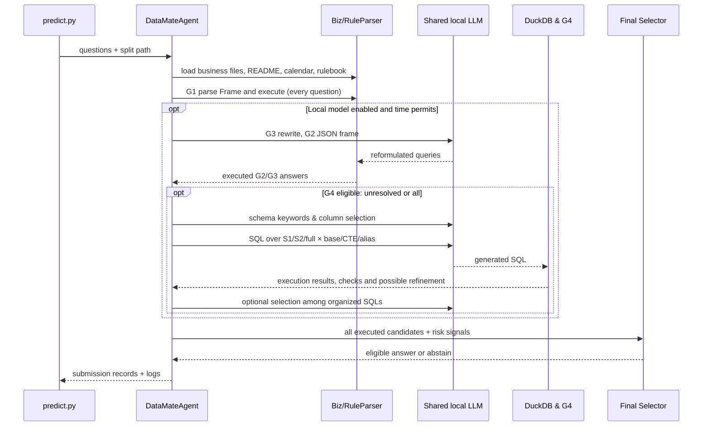

# System architecture and code map

[← Overview](../README.md) · [XiYan algorithms](XIYAN_ADAPTATION.md) · [Evaluation](EXPERIMENTS.md)

This document explains the **actual execution path** in `datamate/agent.py`, rather than presenting a generic multi-agent diagram. It is written for contributors and researchers who need to trace one Vietnamese question to a reproducible answer.

## 1. Design principles and scope

DataMate-XiYan combines (a) a deterministic Vietnamese business-data question-answering engine, (b) **optional** LLM proposals, (c) XiYan-inspired executable SQL proposals, and (d) a **risk-sensitive final selector**. All numerical claims are produced by code operating on business data, not by allowing the LLM to guess numbers.

There are **two distinct selection levels**:

1. **Inside G4:** reorganization of *SQL queries* by their execution results, and an optional shared-LLM SQL selection model (`datamate/select/selection_model.py`).
2. **Across G1–G4:** grouping of *typed answers*, reliability-weighted votes, and eligibility/abstention rules (`datamate/select/selector.py`).

Conflating them leads to incorrect descriptions of the architecture.

## 2. Entry point, files and ownership

| Layer | Responsibilities | Source |
|---|---|---|
| CLI | Parse paths, configure backend, select subsets/folds, optionally compute local PA | `datamate/predict.py` |
| Orchestrator | Group questions by business, load split rulebook/calendar, invoke G1 and optional LLM routes, select answers, flush results/logs | `datamate/agent.py` |
| Ingestion | Read CSV/XLSX/SQLite; detect sheets, headers, value types, semantic roles; construct canonical `Biz` | `datamate/ingest/{reader,roles,builder,readme}.py` |
| Specialized domains | Handle nonstandard phone, repair and notebook/ledger data | `datamate/domains/{phone,repair,books}.py` |
| Semantic parsing | Normalize Vietnamese; extract entity/time/intent/filter/frame; assess coverage | `datamate/textnorm.py`, `datamate/nlu/` |
| Business execution | Interpret frames under business rules and produce typed values | `datamate/engine/{executor,answer}.py` |
| SQL model interface | Local vLLM/Transformers, example retrieval, prompts, M-Schema and SQL generation | `datamate/llm/` |
| Decision | Content checks, SQL reorganization, family-aware final selection | `datamate/select/` |
| Training/evaluation | SFT records and adapters; silver SQL; local scoring and validation | `training/`, `scripts/` |

**Not a free-form agent swarm:** the orchestrator follows a programmed sequence of bounded components. The “multi-generator” concept is at the **proposal level**, not independent autonomous agents or separate LLMs.

## 3. Data contracts

A split directory supplies:

```text
<split>/
  data/<business_id>/    # business README + CSV / XLSX / SQLite files
  questions.jsonl        # id, business_id, question, as_of_date
  rulebook.md            # split-specific business definitions
  calendar.csv           # solar–lunar calendar
  answers.jsonl          # training split only
```

The business README and raw table names are **data sources**, not code instructions. Source formats may differ across businesses and across splits.

### Canonical `Biz` data model

`datamate/ingest/builder.py` constructs a normalized `Biz` object and reconciles common record families (orders, sales lines, products, purchases, payments, inventory and others as available). Its builders normalize statuses, payment/channel representations, dates, currencies and unit-conversion factors. Domain-specific readers augment difficult ledgers.

This is critical: G1 operates on `Biz`, and G4's SQL is generated against **canonical data views**, **not arbitrary original Excel sheet names**.

### Typed result

The internal `Answer` class in `datamate/engine/answer.py` has `type`, `value`, `reason` and `meta`. `to_submission(id)` serializes supported output types; `Answer.key()` provides the deterministic answer-grouping key. A final answer and diagnostics are stored per question.

**Distinguish**:
- `unanswerable` = the data cannot support the requested answer; scored as an answer, possibly wrong.
- `abstain` = decision to avoid answering; yields zero on the challenge's scoring rule.

The CLI produces `submission.jsonl` and by default `<output-directory>/logs/<question-id>.json`, including candidates, decisions and timing metadata.

## 4. Runtime flow



The order in `agent.py` is **G1 → G3 → G2 → optional G4 → final selector**. G1 always attempts a parse. LLM loading is lazy; if the backend cannot start, the program can return to G1-only unless the CLI flag `--require-llm` is provided.

### G4 scheduling

Default `DATAMATE_G4_SCOPE=unresolved` calls G4 for questions for which the preliminary selector **abstains** after G1/G2/G3, and prioritizes questions referencing unfamiliar rulebook rows. `--g4-scope all` processes every eligible question instead; the per-business cap is `DATAMATE_G4_MAX=60` by default. The code also checks the remaining wall-clock budget before expensive steps. Consequently, “LLM enabled” does **not** imply that G4 is run for every question.

## 5. Vietnamese NLU and the symbolic route

1. **Normalization** (`textnorm.py`): deal with diacritics, misspellings, abbreviations and colloquial business terms.
2. **Entity linking** (`nlu/linker.py`): associate item/customer/other references with available business entities.
3. **Temporal resolution** (`nlu/timeparse.py`): resolve periods using each question's `as_of_date` and `calendar.csv`, rather than the machine's current date.
4. **Frame parsing** (`nlu/rules.py`): infer intent, date interval, filters, ranking conditions and expected answer structure.
5. **Execution** (`engine/answer.py` and `engine/executor.py`): calculate using the current split's definitions.

G2 is **not** an autonomous executor of JSON frames: it renders them to a canonical Vietnamese query, which is passed through G1. G3 likewise passes its rewrite through G1. These two routes can rescue difficult phrasing but cannot bypass missing capabilities of the deterministic business engine.

The engine incorporates the split-specific `rulebook.md`; `datamate/rulebook.py` detects diverging interpretations. `datamate/select/form_guard.py` limits overconfident use of rule-engine answers when the question relies on unfamiliar rulebook concepts. **A new rulebook is not automatically guaranteed to be fully implemented** merely because the file was loaded.

## 6. G4: canonical SQL and evidence

`datamate/llm/mschema.py` builds DuckDB-accessible views and M-Schema text. It discovers and **validates** PK/FK relationships and preserves metadata needed for joins, dates and business predicates.

`datamate/llm/evidence.py` retrieves short, question-relevant snippets from the current split's rulebook and business README. This is the evidence `E` in the paper-inspired pathway.

`datamate/llm/schema_filter.py` retrieves candidate columns by lightweight Vietnamese lexical/TF-IDF and value matching, then selects progressively larger filtered schemas `S1` and `S2`, with key and business-condition completion. **The full schema remains a baseline/fallback.**

`datamate/llm/sql_pipeline.py` runs the Cartesian product of retained schemas and `base`, `cte` and `alias` SQL instructions, deduplicates normalized SQL texts, attempts execution in DuckDB and may request **one** self-refine when an SQL fails execution or cannot be converted to a value. `datamate/select/sql_checks.py` flags common semantic failures (missing validity filters, temporal errors, join fan-out, revenue-definition confusion, wrong `LIMIT`, etc.). The SQL selector may then organize candidates and ask the shared model to choose one.

**SQL is validated through execution, not formally proved correct.** A query can execute and still answer the wrong business question; that is why the system needs checks and calibration.

## 7. Selection and uncertainty

`datamate/select/selection_model.py` implements XiYan-like **SQL-level** clustering: group executable SQL candidates by returned value, use consistency/order heuristics, and ask a model when clusters conflict.

`datamate/select/selector.py` implements **answer-level** risk control. Candidates returning the same typed `Answer.key()` belong to one group. Each generator has intent-dependent reliability; candidate risks lower its effective reliability. Multiple outputs of **the same underlying LLM** share a family and cannot act as independent corroborating votes.

For a candidate answer group `g`, the selector computes a heuristic log-odds score based on the reliabilities of families supporting it, minus penalties for *other* families' dissent, plus answer sanity penalties:

\[
s_g=\sum_{f\in g}\operatorname{logit}(r_f)
-\lambda\sum_{f\notin g}\max(0,\operatorname{logit}(r_f))+\text{sanity}(g),\qquad
p_g=\sigma(s_g).
\]

The implementation has additional **conditional** logic for eligibility and dissent. In particular:

- A *clean* G1 answer is an **anchor**: another LLM answer cannot replace it, although disagreement can force abstention.
- LLM-only `unanswerable` cannot replace a G1 value answer.
- A SQL-only group with fewer than two supporting SQL executions has its positive voting strength capped.
- Out-of-vocabulary, type/intent conflicts, top-k ties, changed business rules and suspicious SQL are downweighted.
- The highest eligible group is returned only if `p_g ≥ tau` (default `0.6`); otherwise the agent abstains.

`p_g` is a **heuristic/calibration-derived confidence score**, not a guarantee of a statistically calibrated probability on new businesses. SQL agreement among correlated prompts is not proof of correctness.

**Practical consequence:** G4 might find the right result for a G1 failure, but a poorly calibrated ensemble could still abstain or choose incorrectly. Improving new-business generalization and conditional accuracy on “G1 unresolved” cases is a key research problem.

## 8. Training data and adapters

The [XiYan adaptation document](XIYAN_ADAPTATION.md) details the model-training tasks. At a glance:

- `scripts/build_artifacts.py`: vocabulary, examples and reliability artifacts derived from **training** data.
- `scripts/build_sql_silver.py`: verified SQL produced from training frames, retained when execution matches the known training answer.
- `training/build_sft_data.py`: G2/G3 frame-and-rewrite supervised data.
- `training/build_sql_sft.py`: three SQL formats, question inference, evidence inference, self-refinement and SQL candidate selection (7 task categories).
- `training/sft_lora.py`: multi-task LoRA/QLoRA of **one shared base model**.
- `training/grpo_abstain.py`: **experimental**, PA-aligned GRPO training code; no completed GRPO result is established in this branch.

The Phase-A adapter and held-out fold scores have separate provenance in [models/adapter/TRAINING.md](../models/adapter/TRAINING.md). Model fine-tuning is different from running `python -m datamate.predict`, which performs inference.

## 9. Submission and offline deployment

`predict.sh` expects a read-only test mount at `/data`, writes `/result/submission.jsonl` and per-question `/result/logs/`, and configures offline Hugging Face/Transformers flags. The Docker variants are:

| File | Purpose |
|---|---|
| `Dockerfile` | Base Qwen3-14B image built with weights pre-fetched at build time |
| `Dockerfile.lora` | Base Qwen3-14B plus the Phase-A adapter from Git LFS |
| `Dockerfile.finetuned` | Expects merged fine-tuned model artifacts |

Example local verification (build requires network to fetch model weights; **inference does not**):

```bash
git lfs pull
docker build -f Dockerfile.lora -t datamate-xiyan:lora .
mkdir -p result
docker run --rm --gpus all --network none \
  -v "$(pwd)/data/public_test:/data:ro" \
  -v "$(pwd)/result:/result" \
  datamate-xiyan:lora
python scripts/check_submission.py result/submission.jsonl data/public_test/questions.jsonl
```

Before claiming competition compliance, measure the complete run on a compatible accelerator, verify all local weights and model parameter totals, inspect the per-question logs, enforce the six-hour budget and check rerun reproducibility. **A Dockerfile existing is not evidence that a final offline challenge run has passed.**

## 10. Where to debug

| Symptom | First place to inspect |
|---|---|
| Wrong columns / sheets / business meaning | `datamate/ingest/{reader,roles,builder}.py` and business README |
| Wrong period or Tết interpretation | `datamate/nlu/timeparse.py`, split `calendar.csv` and `rulebook.md` |
| Parsed wrong intent / missing entity | `datamate/nlu/rules.py`, `datamate/nlu/linker.py`, per-question `g1_frame` log |
| G2/G3 outputs not adding candidates | `datamate/llm/generators.py` and `g2_json` / `g3_rewrite` logs |
| No G4 candidates | `schema_filter` and `sql_candidates` logs; `extract_sql`; backend readiness |
| SQL executes but answer is wrong | `datamate/select/sql_checks.py`, SQL result preview, business rule definitions |
| LLM degrades a clean G1 answer | `datamate/select/selector.py`; anchored-vote / `__dissent__` calibration |
| GPU run silently used G1 only | Add `--require-llm`; check `datamate/llm/backend.py` stderr |
| Submission rejected | `scripts/check_submission.py`, `predict.sh`, typed output and per-question logs |

For numbers, experimental variants and caveats, see [EXPERIMENTS.md](EXPERIMENTS.md).