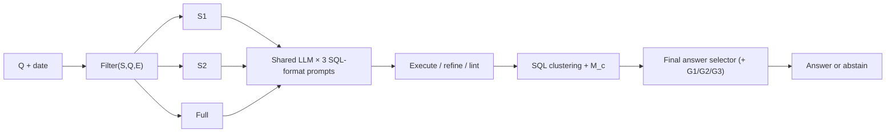

# XiYan-SQL adaptation: concepts, algorithms and implementation

[← Overview](../README.md) · [Architecture](ARCHITECTURE.md) · [Experiments](EXPERIMENTS.md)

This is an **algorithm-to-code guide** for researchers who know the original [XiYan-SQL paper](https://doi.org/10.1109/TKDE.2026.3657851) or want to understand the implementation from first principles. It distinguishes (1) the original algorithm, (2) this project's real code, and (3) missing or modified pieces.

## 1. Why XiYan-SQL is relevant here

XiYan-SQL addresses **Text-to-SQL** by combining:

1. **Schema Filter:** multi-path retrieval and iterative column selection generate multiple schema views.
2. **Multiple SQL Generation:** different generators propose executable SQL candidates over those views.
3. **SQL Selection:** candidates are clustered by execution results, reorganized, and evaluated by a selection model.

DataMate is harder than textbook NL2SQL in other ways: Vietnamese colloquialisms, inconsistent CSV/Excel/SQLite data, business-specific definitions, relative/lunar dates, multiple answer types, and **negative reward for wrong answers**. DataMate-XiYan therefore adds canonical business ingestion, G1–G3 non-SQL routes and a final abstention decision.

**Do not confuse:** `G1–G4` in **this repository** are its local routing names; `SQLG1–SQLG5` in the **paper** are five generator models. Their numbering and identities do **not** correspond.

## 2. Core pipeline and data transformations

Let `Q` be a Vietnamese question, `E` relevant evidence (rulebook/README/date), `S` the business schema after ingestion, and `D` the canonical data.



The `S1/S2/full × base/cte/alias` grid can produce **up to nine initial prompt slots** for a question (subject to filtering, deduplication, scheduling and model errors). These are **prompt variants using a shared model**, not nine independent models or nine independent votes.

## 3. Stage A — M-Schema and multi-path retrieval

**Code:** `datamate/llm/mschema.py`, `datamate/llm/schema_filter.py`, `datamate/llm/evidence.py`.

### M-Schema and canonical views

G4 does not prompt on raw workbook cell ranges. `build_views(biz)` creates structured, queryable views from the canonical `Biz`; `build_mschema(...)` renders tables, columns, examples and **verified** PK/FK metadata. `PFKeyIdentifier` can complete composite and referenced keys only when this metadata is available.

Why? Suppose the question asks for a product name but the join needs `product_key`. Selecting just the label column can make a generated JOIN impossible. Schema filtering must preserve both the requested columns **and** the relational path.

### Retrieval (`S_rtrv`)

In the paper, `K = f_Ms(Q,E)` is an extracted keyword set. Its column relevance score multiplies table-level and column-level embedding similarities:

\[
\operatorname{Score}(k_i,c_j)=
\cos(V_{Q\Vert E},V_{\operatorname{Tab}(c_j)})
\cdot\cos(V_{k_i},V_{c_j}).
\]

The paper also uses edit distance, tokenization/LSH and embedding similarity for values.

**In this repo** `SchemaFilter` combines LLM keywords (when available) with rule-derived keywords; uses **character n-gram TF-IDF cosine similarities** and a Vietnamese lexicon, value indexes and fuzzy matching. It retains columns identified by value mentions. It deliberately does **not** load a separate neural embedding model, to preserve the ≤15B total model-parameter budget.

This is an architectural **approximation** of paper-style multi-path retrieval, not its neural retriever reproduced exactly. The retrieval shortlist `S_rtrv` alone is not expected to contain every necessary SQL column; the next stage recovers critical dependencies.

### Iterative column selection (paper Algorithm 1)

For each of `p_s = 2` rounds:

\[
S_i^{\text{slct}}=f_{M_s}(S_i^{\text{rtrv}},Q,E),\qquad
P_i=\operatorname{PFKeyIdentifier}(S_i^{\text{slct}}),
\]

\[
S_i=\left(\bigcup_{k=1}^{i-1}S_k\right)\cup S_i^{\text{slct}}\cup P_i,
\qquad
S_{i+1}^{\text{rtrv}}=S_i^{\text{rtrv}}\setminus(S_i^{\text{slct}}\setminus P_i).
\]

**Intuition, with no notation:** first ask which columns are relevant, restore all keys needed to join those columns, retain what earlier rounds selected, then remove previously chosen non-key columns from the next round's candidate list. Later rounds can select complementary columns. `S1` is relatively compact (higher precision); `S2` tends to have greater coverage/recall.

**Implementation details:** `run_batch()` calls `llm_keywords_batch()` and `_llm_select_batch()` when the LLM is available; otherwise `_heuristic_select()` is used. `pf_key_identifier()` connects tables through verified foreign keys; `business_columns()` preserves essential date/validity/status conditions. If no filtered schema is valid, the full M-Schema remains available. The actual code explicitly adds business guard columns **in addition** to the paper equations.

This explains why a naive column-only shortlist is inadequate for complex retail SQL: correct aggregations need joins, filters, dates, entity IDs and business semantics.

## 4. Stage B — Multi-SQL generation (paper Algorithm 2)

**Code:** `datamate/llm/sql_pipeline.py`, `datamate/llm/prompts.py`, `datamate/llm/generators.py`.

### Original method

XiYan-SQL uses **five different SQL generators**: the paper's SQLG1–SQLG4 are separately fine-tuned expert models emphasizing multi-task, structural, stylistic and mixed training; SQLG5 is an in-context-learning generator. With two schemas, the reported configuration initially yields **ten** candidates. Execution errors or anomalous outputs can trigger self-refinement. These models are not interchangeable with a single model prompted five ways.

### This implementation

`DEFAULT_GENERATORS` defines three routes using the **same backend**:

| Local SQL route | Instruction goal | Interpretation |
|---|---|---|
| `G4_base` | Conventional SQL | Baseline generation |
| `G4_cte` | Prefer Common Table Expressions | **Structural** diversity |
| `G4_alias` | Encourage explicit aliases/stylistic conventions | **Stylistic** diversity |

The pipeline calls them over valid `S1`, `S2` and `full` schemas (a third, safety-focused view). Before execution it extracts SQL from the model output and de-formalizes/deduplicates equivalent SQL **texts**. It logs each query's schema ID, generator format, model family, timings, token counts, execution preview, value/error, flags and duplicate provenance.

If a candidate **fails** or produces an unusable/`None` value, it may be sent through **one** `self_refine_user` feedback prompt. The code does **not** implement every paper criterion for semantic anomaly detection; a plausible but wrong numerical result can pass execution.

The SQL executor is `SQLRunner` over the canonical views with restricted read-only intent. The linter in `datamate/select/sql_checks.py` checks common logical errors, including missing required predicates, incorrect date bounds, dangerous join multiplicity and incorrect financial measures. An SQL passing these checks is **not proof** of a correct answer.

### Why diversity is useful but not independent evidence

Two SQLs can compute the same answer, but both can be wrong for the same reason (e.g., both forget returned items). Similarly, all three local G4 routes can inherit the **same shared-LLM failure**. Their consistency is used within G4; their contributions to the final answer are merged into one LLM **family** to avoid false confidence.

## 5. Stage C — SQL selection (paper Algorithm 3)

**Code:** `datamate/select/selection_model.py`.

The paper's procedure, adapted here, is:

1. Normalize/de-formalize candidate SQL expressions and group *successfully executed* candidates by result.
2. When every candidate yields one result, use the **shortest** SQL as a simple consistent representative.
3. Otherwise, order clusters by size, and candidates within each cluster by generator reliability.
4. If the largest cluster holds at least `ceil(N/2)` candidates, present the reorganized list; if not, present the **shortest candidate per cluster** to reduce distraction.
5. Ask the selection model `M_c(Q,S_union,E,candidates)` to choose an SQL.

**Important implementation limits:** `SelectionModel` is the **same local Qwen backbone**, not a separately trained 7B selector as in the published configuration. `max_candidates=8` limits the displayed list, and a candidate must already execute successfully to be eligible. A selected SQL is converted to an **answer proposal**; it cannot override the final decision threshold. `G_select` shares the LLM model family and is **not** counted as an independent model vote.

The final answer selector (`datamate/select/selector.py`) is a **second**, competition-specific decision mechanism; see [Architecture `7](ARCHITECTURE.md#7-selection-and-uncertainty).

## 6. G1–G4 and paper SQLG1–SQLG5: explicit comparison

| Issue | Original XiYan-SQL | DataMate-XiYan |
|---|---|---|
| Input | Natural-language question, DB schema, external evidence | Vietnamese question + date, raw business files and split rules → canonical `Biz` and evidence |
| Schema filter | Neural multi-path table/column/value retrieval + iterative column selection | TF-IDF/lexicon/value matching + LLM or heuristic column selection + validated PK/FK + business guards |
| Schema variants | Two filtered schemas | `S1`, `S2`, and full-schema baseline/fallback |
| Generators | Five models (four distinct fine-tuned experts + ICL model) | Shared Qwen3-14B used with **three** G4 prompt formats, alongside G1 symbolic, G2 frame, G3 rewrite |
| Refinement | Execution-guided self-refine | One retry on execution failure or missing usable value |
| SQL selection | Fine-tuned selection model + candidate reorganization | Same backbone, prompted SQL selector + reorganization |
| Final decision | Select best SQL | **Extra answer-level selector** with confidence guards, conditional LLM reliability and abstention |
| Competition scoring | Execution Accuracy on BIRD/Spider | Penalized Accuracy on typed DataMate answers |
| Verified claims | Paper's BIRD/Spider results are the authors' | This repo's own reported measurements are documented in `RESULTS.md` / `EXPERIMENTS.md` |

This project is correctly described as **“XiYan-inspired multi-path Text-to-SQL inside a neuro-symbolic selective-answering system.”** Describing it as “a faithful reproduction of all five XiYan generators” would be inaccurate.

## 7. Training data: source, objectives, and limitations

**Training-only construction:**

```bash
python scripts/build_sql_silver.py data/train
python training/build_sft_data.py --split data/train --out outputs/sft.jsonl --n-aug 3
python training/build_sql_sft.py --split data/train --out outputs/sql_sft --n-aug 2
```

`build_sql_silver.py` first derives SQL from **G1 frames on labeled training examples**, executes it, and keeps queries whose typed outputs match the reference. This makes a **silver SQL** corpus grounded in execution. It is not hand-annotated gold SQL from the organizers, and it inherits the coverage/inductive bias of G1.

`build_sql_sft.py` prepares:

| Task | Input → expected output | Research purpose |
|---|---|---|
| `nl2sql_base` | Question + E + schema → standard SQL | Core NL2SQL |
| `nl2sql_cte` | Same → structured/CTE-style SQL | Structural diversity |
| `nl2sql_alias` | Same → alias/stylistic SQL | Format diversity |
| `question_inference` | SQL + schema + evidence → Vietnamese question | Reverse semantic alignment |
| `evidence_inference` | Question + SQL + evidence candidates → relevant rule evidence | Business-rule alignment |
| `self_refine` | SQL near-miss + feedback + Q/E/schema → corrected SQL | Error recovery |
| `select` | Question + E/schema + candidate SQL list → selected index | Listwise candidate discrimination |

Controlled SQL mutations in `datamate/llm/sql_mutations.py` provide hard near-miss negatives. This mirrors ideas from the paper, but task **data generation** alone is not evidence that training improved a downstream benchmark.

`training/sft_lora.py` trains **one** multi-task adapter rather than four separately tuned SQL generators. `models/adapter/TRAINING.md` records one Phase-A QLoRA run (rank 32, held-out fold 0). Phase-B full-training and dedicated generator-specific fine-tuning are **not established** in the supplied record. Inspect the exact adapter config and count all weights used at inference.

## 8. Abstention and the second paper

The ICLR 2026 paper *When Silence Is Golden: Can LLMs Learn to Abstain in Temporal QA and Beyond?* studies temporal question answering, CoT-assisted supervised fine-tuning and GRPO with abstention-aware rewards. Its experiments are **not** DataMate experiments.

For DataMate's reward, if `p` is the probability a proposed answer is correct:

\[
\mathbb{E}[R\mid\text{answer}]=p(+1)+(1-p)(-1)=2p-1,\quad
\mathbb{E}[R\mid\text{abstain}]=0.
\]

Thus `p > 0.5` favors answering under perfect calibration; the implementation uses `tau=0.6` as a **heuristic margin**, and also enforces rulebook, coverage, SQL support and anchor checks.

`training/grpo_abstain.py` defines an experimental reward with **+1 for correct, −1 for wrong, 0 for abstain**, using a generated frame interpreted by the deterministic engine. Unlike the research paper's published CoT+RL measurements, **no confirmed GRPO-trained improvement is documented here**. Do not conflate an algorithm implemented in a script with a trained and evaluated artifact.

## 9. Open research questions (specific, testable)

1. **Unseen business generalization:** does new-schema recall remain high when raw sheets, header vocabulary and business categories change? Test at the **business** level, not just a random question split.
2. **G4 reliability conditional on G1 failure:** benchmark G4 specifically where `G1` abstains; a high overall LLM-only score can hide weak *incremental* coverage.
3. **Schema filtering:** compare G4 final PA with S1, S2, full only, and combinations; report both column coverage and downstream correctness.
4. **Candidate diversity:** separate structurally distinct, truly successful SQLs from cosmetic edits of one SQL; track oracle@k vs actual selector accuracy.
5. **Selection and calibration:** compare execution-majority, `M_c`, family-aware answer selector, fixed thresholds and calibrated abstention. Ensure each generator/selector is scored on held-out businesses.
6. **Model parameter/latency budget:** any additional independent model or LoRA adapter must fit the **total** ≤15B rule; measure full offline Docker latency on the organizer's reference hardware.
7. **Rulebook drift and wrong-but-executable SQL:** create controlled training-only stress tests for cancellation/returns, ranking ties, lunar dates and revenue/payment distinctions.

These are **proposed experiments**, not claimed completed ablations. Read [EXPERIMENTS.md](EXPERIMENTS.md) to separate implemented checks from empirical evidence.

## 10. References

- Yifu Liu et al., [XiYan-SQL: A Novel Multi-Generator Framework for Text-to-SQL](https://doi.org/10.1109/TKDE.2026.3657851), *IEEE Transactions on Knowledge and Data Engineering*, 2026. See `III-B` (schema filter), `III-C` (multiple generation), `III-D` (selection), Fig. 1–3, Algorithm 1–3.
- Xinyu Zhou et al., *When Silence Is Golden: Can LLMs Learn to Abstain in Temporal QA and Beyond?*, ICLR 2026, sections on CoT-SFT, GRPO and the reliability of abstention.
- Challenge-provided `Description.txt`, `Data.txt`, `Rule.txt` and `Evaluation.pdf` define **DataMate** scoring, split files and deployment constraints and take precedence over general text-to-SQL assumptions.
